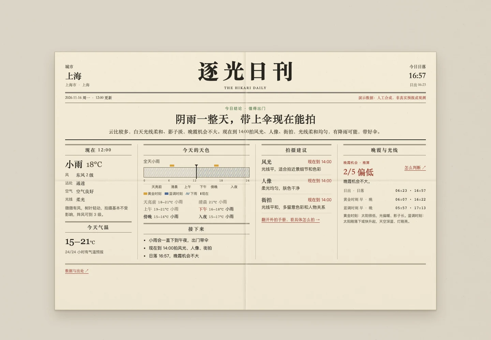
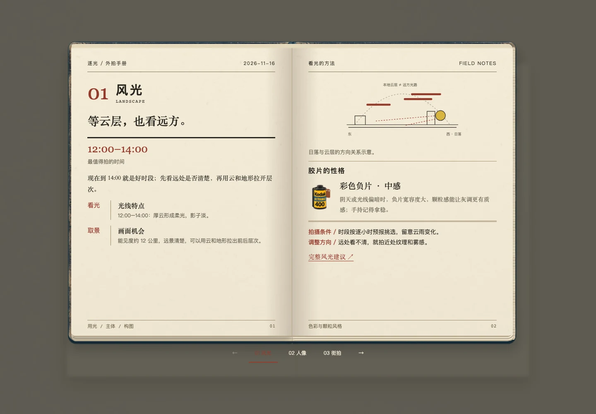
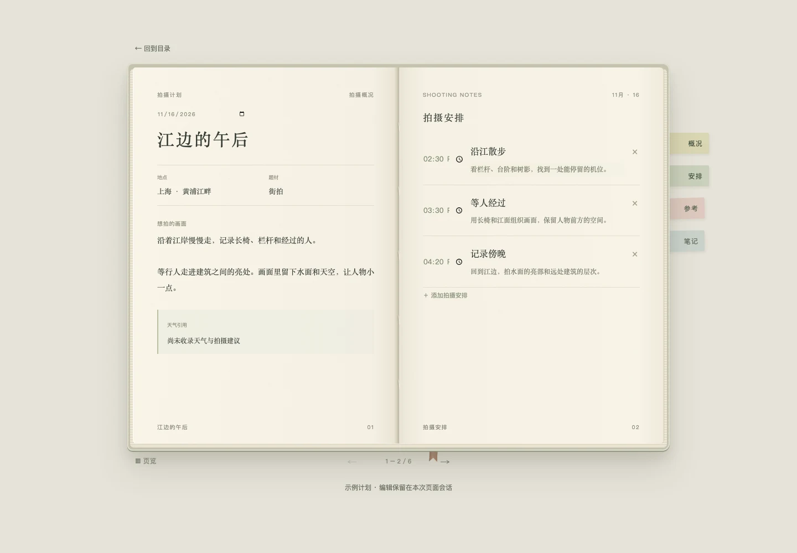
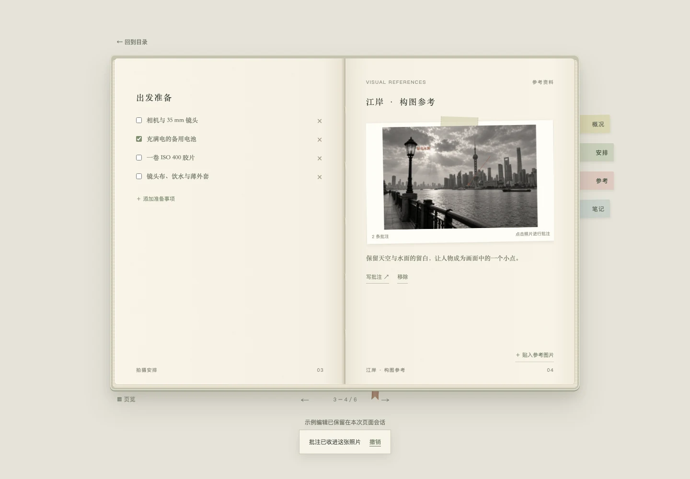

<div align="center">

# 逐光日刊

**HikariDaily**

摄影天气日报 · 随身仪表 · 外拍手册 · 拍摄计划本

[交互展示](https://jay201368.github.io/HikariDaily/) · [本地运行](#本地运行) · [开发文档](docs/DEVELOPMENT.md)

</div>



选择地点，阅读当天的天气与光线。逐光将 24 小时预报、太阳位置、拍摄建议和出发计划放进一份报纸、一个摄影包与两本随身书。

## 从报纸到背包

向下滚动，报纸沿两道折痕收起，落入摄影包。拨动 24 小时表盘，包里的仪表随之更新。点击器材，查看对应小时的读数、趋势和解释。


| 物件 | 可以查看的内容 |
| --- | --- |
| 摄影天气日报 | 当天概览、气温变化、天色时间轴、三题材拍摄时段、日出日落与晚霞 |
| 叶轮风温湿仪 | 平均风、阵风、温度、湿度及逐时变化 |
| 太阳方位仪 | 所选小时的太阳方位与高度 |
| 测光表意象 | 光线软硬、明暗与适合的拍摄方式 |
| 气象记录卡 | 云量、降水、能见度、空气质量与颗粒物 |
| 24 小时表盘 | 拨针、键盘或前后小时按钮选时，联动所有仪表 |

日报与仪表都能继续打开逐时明细、晚霞解释和数据出处。预报、天文计算、摄影推断分别标识，来源时间与缺失状态随内容保留。

## 翻开外拍手册

深蓝封皮从背包中提起，在书脊处展开。风光、人像、街拍各占一个对开，纸页按原有方向翻动。时段、用光、主体、构图和胶片建议集中在书页中，完整建议可继续展开阅读。



连接自己的模型后，天气事实与摄影知识共同参与生成报纸和手册里的建议。账户设置支持兼容模型服务地址、模型名称、API Key 与能力检测。默认提供规则建议，生成状态和知识依据可查看。

## 写进拍摄计划本

浅米白纸页、锁线书脊和外伸便签组成另一册手账。打开目录，进入一份计划，在对应位置直接编辑文字。



- **安排拍摄** — 记录地点、日期、题材、想法、日程和准备清单。
- **整理参考** — 贴入图片，添加说明，用画笔、箭头、文字或框选做批注，支持裁剪与旋转。
- **连续书写** — 长文自动续页，支持手动分页、资料页、缩略图和栏目跳转。
- **管理计划** — 搜索文字与批注，复制计划，移入回收夹或恢复。
- **保存与同步** — 未登录时保存在本机，登录后可显式导入并开启账户同步。



## 交互展示

直接打开 **[在线交互展示](https://jay201368.github.io/HikariDaily/)**，也可在本地启动项目后访问 `/showcase`。

展示页沿用正式产品的物件素材、折报动作、仪表、手册翻页和计划本编辑器。可滚动收报、取用器材、拨针选时、翻阅三种题材，并编辑「江边的午后」示例计划。

页面与本文画面使用标注清楚的人工天气和计划样例。展示中的编辑保留在本次页面会话，刷新恢复初始内容。展示页支持减少动态、键盘操作与章节直达，面向桌面浏览。

## 本地运行

需要 Node.js `>=24.3.0 <25` 与 pnpm `11.26.0`。

```sh
pnpm install --frozen-lockfile
pnpm dev
```

- [打开应用](http://localhost:3000) — 选择中国大陆城市或区域，加载当天简报。
- [打开展示页](http://localhost:3000/showcase) — 使用固定样例体验界面与交互。

核心天气页面可直接启动。账户、模型配置与账户计划同步使用 PostgreSQL 15+，环境配置参考 [.env.example](.env.example)。准备数据库与服务端配置后执行以下命令。

```sh
pnpm workspace:migrate
pnpm workspace:knowledge import src/content/knowledge/original-fieldcraft.v1.json
```

在应用顶栏注册账户并配置模型。来源配置、缓存、检查命令与数据库操作见[开发说明](docs/DEVELOPMENT.md)。

## 实现结构

| 部分 | 实现 |
| --- | --- |
| 应用 | Next.js App Router、React、TypeScript |
| 物件交互 | 原生 DOM、CSS 3D 与 Web Animations API |
| 天气与建议 | LangGraph 编排来源、归一化、太阳计算、摄影判断与中文解释 |
| 天气来源 | GFS、MET、CAMS 与 ECMWF 空间云场 |
| AI 摄影建议 | 账户模型配置、条件检索的摄影知识、结构化生成与内容校验 |
| 拍摄计划 | 独立纸页编辑器、IndexedDB、本机与 PostgreSQL 账户同步 |
| 数据契约 | Zod、北京时间 24 小时对齐、来源与缺失状态追踪 |

晚霞分析沿日落方向采样本地与远处的空间云场，结合受光、遮挡、能见度和降水生成判断。账户模型凭证在服务端加密，计划与图片按账户隔离。

[产品需求](requirement.md) · [详细规格](spec.md) · [架构](docs/ARCHITECTURE.md) · [当前设计](docs/DESIGN_REFERENCE.md) · [拍摄计划本设计](docs/SHOOTING_PLANNER_DESIGN.md)

## 来源与项目状态

天气与数据来源说明见[数据来源](docs/data-sources.md)，物件、纹理和展示画面的来源记录见[素材出处](public/PROVENANCE.md)。摄影知识的许可随知识条目保存。

订阅纸单目前提供界面预览。真实微信订阅、发送与调度属于后续阶段。其余待核验事项集中记录在[当前状态](docs/CURRENT.md)。
