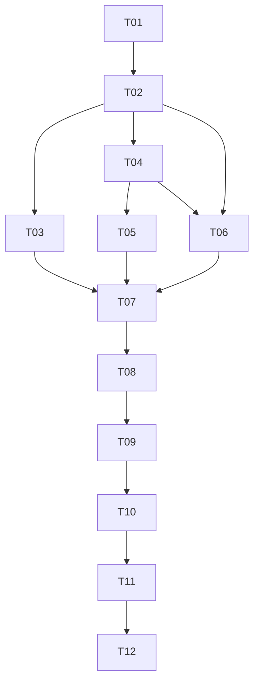

# 正式应用任务 DAG

## 协作与验收

使用全新的生产 T01–T12，与 docs/archive/visual-prototype 的同号历史卡无关。每卡一个全新隔离 worker，最多一个实施worker；不递归委派，不复用到其他ID。主agent维护权威文档、验收与阶段本地Git提交；worker仅在指定范围编码、记录待验收证据，不勾选、不commit。接口变化先主agent更新架构与受影响卡。依赖须已验收且有证据。

## 依赖

## A：基础与数据验证（T01–T04）

### [x] T01 — 可复现正式应用骨架

**Dependencies:** None
**Worker:** spec-worker-sol-medium
**Routing rationale:** 工具链与框架集成边界明确，需要核对兼容版本和可复现构建。
**Scope:** 根package/lock/config、src/app基础入口、测试配置、tests基础、.env.example基础、README及docs/DEVELOPMENT命令节。保留原型与用户文件，不实现气象和物件。
**Acceptance:**

- 锁定官方registry真实可用的兼容稳定版本，SunCalc固定1.9.0；pnpm与Node要求明确。TypeScript strict，Zod、Motion、Vitest、Playwright就绪。
- 首页中文刊名、未选地点提示和真实的开发状态，无假天气；基础宽窄浏览器smoke。
- 标准dev/typecheck/lint/test/test:e2e/build/start可重复运行；不依赖外部字体或上游API构建。
- 提供依赖版本、实际命令、构建和测试证据，.gitignore排除测试产物。
**Verification:** `pnpm install --frozen-lockfile`, `pnpm typecheck`, `pnpm lint`, `pnpm test`, `pnpm test:e2e`, `pnpm build`；启动/停止说明。

**Completion:** 2026-10-22，工具链/无地点首页验收；主agent独立 frozen install、typecheck、lint、test（2/2）、test:e2e（3/3）、build 均 exit 0，窄屏截图通过。dev/start HTTP200及Ctrl-C由worker验证。ESLint9兼容限制、下载失败与代理修复见 [证据](verification/T01.md)。

### [x] T02 — 领域契约、北京时间与太阳计算

**Dependencies:** T01
**Worker:** spec-worker-sol-high
**Routing rationale:** 公开schema、跨日和星历角度对全链路正确性影响大。
**Scope:** src/domain/types、schemas/time/solar，tests/unit及显式标注的领域fixture。按架构补齐完整Briefing及其嵌套schema；不实现上游与摄影排序。
**Acceptance:**

- spec §5与架构补充结构一一对应；TS从Zod推导，missing-null、24h和ISO等约束有失败样例。
- UTC机器仍生成北京时间24连续小时，跨日正确；无域内隐式clock/network。
- SunCalc1.9.0一次注册、五城市固定日星历、事件顺序/日期、方位转换、无效事件均有测试。
**Verification:** `TZ=UTC pnpm test`, `TZ=Asia/Shanghai pnpm test`, `pnpm typecheck`, `pnpm lint`, `pnpm build`。

**Completion:** 2026-10-22，完整领域契约、显式北京时间及五城市太阳适配验收；主agent独立双时区test各40/40、typecheck/lint/build均exit0，diff检查通过。人工合成/固定库回归的限制见 [证据](verification/T02.md)。

### [x] T03 — 中国大陆地点搜索与解析

**Dependencies:** T02
**Worker:** spec-worker-sol-medium
**Routing rationale:** 稳定契约下的地名适配与参数校验，需行政上下文和服务范围测试。
**Scope:** src/server/providers/geocoding、地点缓存接口、src/app/api/locations、tests/contracts地点样例，docs/data-sources.md地点部分。不建天气或选择器UI。
**Acceptance:**

- 固定Open-Meteo地名API，中文CN、24h缓存、2–40字符、最多10项、geonames ID解析，非大陆/村落/不明层级被过滤，保留城市回退说明和GeoNames署名。
- 200空/结果，400无效，404解析不存在，503源故障信封一致；输入不开放URL/坐标代理，安全文本。
- 海淀、同名异地、五常用城市、区县不可查等固定契约样例；实时检查独立记录，未运行不当通过。
**Verification:** `pnpm test`, `pnpm typecheck`, `pnpm lint`, `pnpm build`；独立真实地名请求检查并记录环境限制。

**Completion:** 2026-10-23，地点搜索与解析验收；主agent审查固定主机、白名单、缓存/错误信封并独立test（101/101）/typecheck/lint/build均exit0。worker真实检查成功的样例与覆盖限制见 [证据](verification/T03.md)。

### [x] T04 — 多源适配与小时归一化

**Dependencies:** T02
**Worker:** spec-worker-sol-high
**Routing rationale:** 前/后一小时累计、分层云与逐源风险需要严格语义处理。
**Scope:** src/server/providers/{open-meteo,met-norway,air-quality}、共享固定主机fetch工具、src/domain/normalization、源内部schema、WeatherCodeSchema及其97回归测试、tests/contracts与fixture、docs/data-sources.md。不实现共享缓存调度/Briefing服务。
**Acceptance:**

- 主GFS、MET complete、CAMS global全部Zod校验；官方已知97强雷暴保留，其他未知码/非法范围/字段缺失null；固定endpoint和4s可取消请求。
- Open-Meteo前一小时累计/阵风/概率正确移位，MET next_1_hours向后，次日00只补23时；保留24格、metadata、插值和US_EPA。
- 主源逐字段回退、阈值冲突、云层不混用，保留备用源风险输入；主源缺分层即不拼晚霞。
- MET缺真实User-Agent明确disabled；许可/字段/覆盖官方检查及独立实时检查的结果和限制如实记录，不伪造联系信息。
**Verification:** `pnpm test`, `pnpm typecheck`, `pnpm lint`, `pnpm build`；独立live source脚本或明确跳过原因。

**Completion:** 2026-10-23，三源适配/归一化与97兼容修正验收；主agent审查全部实现并独立test（174/174）/typecheck/lint/build均exit0。北京GFS/CAMS live字段成功、MET无身份跳过，详见 [证据](verification/T04.md)。阶段A全部接受。

## B：真实内容闭环（T05–T08）

### [x] T05 — 共享源缓存与受控聚合

**Dependencies:** T04
**Worker:** spec-worker-sol-high
**Routing rationale:** 缓存时效、跨实例契约、429与并发取消是服务正确性边界。
**Scope:** src/server/cache、source-loader/config、测试、.env.example、运行配置说明、精确锁定的@vercel/functions适配依赖。不生成摄影结论或完整Briefing。
**Acceptance:**

- 平台共享读写缓存封装（官方Vercel Runtime Cache适配，可替换业务边界），完整版本化键；15min重验证，复用不改fetchedAt；失效失败≤3h且目标范围覆盖才能stale，超限missing。
- 三源并行4s/聚合6s，不立即重试；MET Expires/条件请求/304，429 Retry-After行为有可控clock契约测试。缓存不可用的显式降级、MET fail-closed和跨实例配额限制明确，禁止私有API或本机Map冒充共享缓存。
- 服务端源开关、MET身份校验；fixture显式非生产且无静默回退；日志不泄露联系方式/内部异常。
**Verification:** `pnpm test`, `pnpm typecheck`, `pnpm lint`, `pnpm build`。

**Completion:** 2026-10-23，可替换平台缓存/源加载器验收；主agent审查全部cache/config/loader/fixture及测试，独立test209/209、typecheck/lint/build全exit0。真实Vercel/MET未调用，共享性验证开关默认关闭，SDK回退/计费门禁见 [证据](verification/T05.md)。

### [x] T06 — 摄影规则与三题材中文建议

**Dependencies:** T02, T04
**Worker:** spec-worker-sol-high
**Routing rationale:** 规则切片、风险优先、排序与晚霞限级存在高耦合正确性要求。
**Scope:** src/domain/photography、src/content、规则测试。仅纯函数，输入now/源风险/主分层明确；不拉网络或改UI。
**Acceptance:**

- spec §6所有阈值、分量、三题材权重、原因集合合并≤2h、最低分排序、裁剪/15min/最多3项/50门槛实现并测试。
- 每有效来源风险先判（雷暴95/96/97/99），备用危险不能被主值覆盖；缺必要值不排名，AQI未知不称安全。
- 晚霞五级含spec八组基准、unknown、旧/分歧限3和无云/遮挡/雨限2，固定限制和版本号；光照不输出EV/lux。
- 三题材有各自时机、光线、画面、限制、替代、通用胶片；概览风险先行且过去未来时态正确。
**Verification:** `pnpm test`, `pnpm typecheck`, `pnpm lint`, `pnpm build`。

**Completion:** 2026-10-23，纯摄影规则/三题材文案验收；主agent审查全部规则/内容与测试，独立test331/331、typecheck/lint/build全exit0。规则是初版启发式，不证明预测精度；入口及边界见 [证据](verification/T06.md)。

### [x] T07 — 同一简报服务贯通 SSR 与 API

**Dependencies:** T03, T05, T06
**Worker:** spec-worker-sol-high
**Routing rationale:** 多模块组装与错误状态需保持公开契约和实时日期一致。
**Scope:** src/server/briefing-service、src/app/api/briefing、src/app/page、基础可读简报组件与服务测试；可编写可控fixture注入。不做复杂场景动效。
**Acceptance:**

- 服务显式now解析地点、取源、归一化、星历、规则与24h，输出schema验证通过，SSR/API直接共用；规则结论不整页缓存。
- 200 ready/partial/stale，400/404/503信封，全部气象无值503并保留太阳事件；MET disabled可见；不以星历代天气。
- 正常文档顺序呈现概览、小时、太阳、晚霞、三题材、来源和缺失；无地点不假数据；fixture醒目标注。
- 同地点/日期内容一致，API不接受任意日期/坐标/URL代理；含未来消息摘要复用函数但无发送。
**Verification:** `pnpm test`, `pnpm typecheck`, `pnpm lint`, `pnpm build`，SSR/API契约及全部失败检查。

**Completion:** 2026-10-23，同一BriefingService/SSR/API与可读文档验收；主agent独立typecheck/lint/test369/369/build全exit0，显式fixture+测试地名preload E2E9/9，查看宽窄截图通过。动态路由/全部失败保星历及验证限制见 [证据](verification/T07.md)。

### [x] T08 — 地点、小时、题材与刷新状态

**Dependencies:** T07
**Worker:** spec-worker-sol-high
**Routing rationale:** 请求竞态、跨日、可见性与URL状态需要跨组件时序验证。
**Scope:** 地点选择器、hour-strip、题材导航、客户端刷新控制及E2E；沿用可读内容不做物件动画。
**Acceptance:**

- 300ms防抖、一字不请求、行政上下文、无结果城市提示；URL优先/本地记忆，genre非法默认。
- 切地点取消并丢弃旧响应，清小时；选小时不重取天气、只更新小时读数；题材不重算结论。
- 前台15min、隐藏暂停/恢复检查、北京时间零点换日、手动重试经过同缓存；加载/部分/旧/整体失败不混入假值。
- 键盘/触摸可操作，来源详情显示预报/计算/推断及参考AQI和CAMS口径。
**Verification:** `pnpm test`, `pnpm typecheck`, `pnpm lint`, `pnpm test:e2e`, `pnpm build`。

**Completion:** 2026-10-23，地点/选时/题材/刷新与竞态控制验收；主agent审查controller/UI及测试，独立typecheck/lint/test382/382/build全exit0，显式fixture E2E21/21，窄屏选时截图通过。主agent同步修正已过时页面description。详情及模拟可见性限制见 [证据](verification/T08.md)。阶段B全部接受。

## C：完整物件体验（T09–T10）

### [x] T09 — 报纸、皮包仪表与黄色手册

**Dependencies:** T08
**Worker:** spec-worker-sol-high
**Routing rationale:** 原型视觉移植和可变长度真实数据的可读布局复杂。
**Scope:** src/components/{newspaper,bag,instruments,handbook,source-notes}、CSS Modules、public本地物件与素材出处、视觉E2E。此卡先完成静态完整阅读，不改领域规则。
**Acceptance:**

- 按DESIGN_REFERENCE和原型复现报刊层次、真实包体分层、三器材+记录卡、无链24h表、黄手册；文字为DOM，器材LCD不溢出；未核实资产保留出处并列发布门禁。
- 同一Briefing映射所有物件，24h表盘触摸/箭头/Home/End/±1、详情Escape与还焦；太阳方位计算含义明确，不冒充朝向。
- 宽/窄静态、长地点/缺失/故障均无核心文字截断；三题材各自内容，手册按钮及窄屏原生横滑；未来订阅纸单不保存或发送。
- 本地字体/纹理，核心内容不等装饰下载；逐项视觉截图评审。
**Verification:** `pnpm typecheck`, `pnpm lint`, `pnpm test`, `pnpm test:e2e`, `pnpm build`；宽窄截图人工审查。

**Completion:** 2026-10-23，报刊/写实包体/器材/表盘/黄手册静态验收；主agent独立typecheck/lint/test382/382/build、显式fixture浏览器30/30全部exit0，实际查看宽报纸、宽窄包体和黄手册截图。素材逐字节继承且仍有发布权门禁，详见 [证据](verification/T09.md)。本卡不声明连续动画完成。

### [x] T10 — 可逆双折入包与抽册翻页

**Dependencies:** T09
**Worker:** spec-worker-sol-high
**Routing rationale:** 几何遮挡与可逆场景有复杂视觉风险，首次不派Astra。
**Scope:** 场景时间轴、折叠/收纳/表盘/手册/纸单动效、阅读模式和场景E2E。不改数据服务/摄影规则。
**Acceptance:**

- 两次独立折叠后缩放对准主仓下放，只有跨袋口部分遮挡；表盘/手册先完全提清再移位，手册放大展开；三题材桌面滚动翻页，手机原生横滑。
- 额外翻页发现完整纸单，抬起移动放大落定，尾声分组进入且交接正常流前完整；全程可逆，有稳定阅读区间，适应内容长度。
- 不接管原生滚动；装饰副本inert/隐藏/无重复ID；过渡控件不获焦。减少动效/用户静态模式保留全部内容和操作。
- 宽窄关键帧及反向路径截图/几何/浏览器检查，不能用淡出换景代替关键动作。
**Verification:** `pnpm typecheck`, `pnpm lint`, `pnpm test`, `pnpm test:e2e`, `pnpm build`；主agent检查完整正反路径。

**Completion:** 2026-10-23，双折/对准入包/提表抽册/翻页/完整纸单可逆路径验收；主agent审查并独立typecheck/lint/test385/385/build、fixture E2E42/42全过，查看宽窄正反关键帧与人像稳定阅读。主agent发现cleanup焦点缺陷，经同T10 worker复现2/2失败→修正2/2通过后全套42/42；见 [证据](verification/T10.md)。阶段C接受，真实设备/授权门禁保留。

## D：异常与发布准备（T11–T12）

### [x] T11 — 全链路回归与真实来源证据

**Dependencies:** T10
**Worker:** spec-worker-sol-high
**Routing rationale:** 异常状态、跨日竞态与领域到物件一致性是跨模块验收。
**Scope:** 端到端fixture场景、回归修复（已授权risks.ts将RiskNote显式字段投影，修复真实风险触发503）、live检查工具、docs/verification.md，以及Next/Playwright公开配置的测试输出隔离（.next-e2e和独立tsconfig，保留普通开发服务）。不改变已定公共契约；发现变更先报告。
**Acceptance:**

- spec §9矩阵覆盖至自动/人工/外部待验三类，宽窄+减少动效搜索/选时/翻册/来源/异常/旧/冲突/全部失败/跨日/迟到响应有证据。
- 五城市及典型区域实时请求独立于fixture记录来源字段、地点粒度、时效、覆盖、限制；MET缺contact不能伪造；无法联网不宣称通过。
- 检查核心值/来源/时间一致、无客户端上游网络/秘密、无假实况或伪概率、原型仍独立。
**Verification:** `pnpm typecheck`, `pnpm lint`, `pnpm test`, `pnpm test:e2e`, `pnpm build`，live验证独立报告。

**Completion:** 2026-10-23，spec§9验证矩阵、跨物件字段/来源/异常回归及六地真实API/SSR证据验收。修复风险对象泄漏内部字段造成503，四风险回归通过；公开Next配置隔离浏览器目录，保留普通开发服务。主agent独立test389/389、显式fixture E2E45/45、typecheck/lint/build均exit0，并核对20行live摘要与窄屏图像。MET/真实共享缓存/许可/大陆部署与实体设备仍未验；首次目录锁失败和纠正详见 [T11证据](verification/T11.md)。按用户最新要求在本卡本地提交后停止，T12未启动。

### [ ] T12 — Serverless发布准备与交付门禁

**Dependencies:** T11
**Worker:** spec-worker-sol-medium
**Routing rationale:** 部署配置和许可/运行文档按稳定边界收尾，外部验证明确分开。
**Scope:** 最小Vercel/Node配置、环境自检、来源/素材/依赖许可清单、README/运行及发布验收说明。禁止push、公开部署、付费开通或虚构外部验收。
**Acceptance:**

- 锁文件安装/生产构建/本地start及同源API可运行；确认Runtime Cache启用配置与套餐预算门禁；无数据库/Cron，配置/停服/回滚说明明确，生产拒绝fixture。
- 列明免费用途、真实MET标识、素材权利、共享缓存与额度、实际大陆电脑/手机访问门禁；已验证与待用户/环境验证分开。
- 全任务/文档一致，交付可审查本地成果。公开部署需后续明确授权及相关门禁证据；不得把本卡通过称为已上线或全国覆盖验证通过。
**Verification:** `pnpm install --frozen-lockfile`, `pnpm typecheck`, `pnpm lint`, `pnpm test`, `pnpm test:e2e`, `pnpm build`，`pnpm start` smoke，workflow validator及diff/链接检查。

## V01：T09/T10视觉验收纠偏（事后回填，2026-10-23）

用户要求本会话先定位并直接修复相对prototype的严重漂移，再回填过程文档。主agent完成展示/动作/交互修复，没有先改卡派发实施worker；一名explorer仅做只读差异审查。本项不是T12，也不新增假配置worker的任务卡。

历史T09/T10的完成框保留为当时记录；其中视觉忠实度判断不足，由 [V01证据](verification/V01-visual-drift.md) 的问题边界、修正和最终结果补正。最终typecheck/lint/build、本地start、389/389与fixture E2E48/48通过，新增首屏/器材/封面连接/双面翻页/纸单承托/过渡焦点的浏览器检查。T12仍未启动。

V01用户复核补正：移除皮包下遗留的普通文档面板及重复入口，完整小时表/字段改为表盘明细对话框，器材说明由本体打开；旧测试迁移到真实入口，新增“默认不外露面板”的断言。最终389/389、48/48及typecheck/lint/build通过；见同一证据文件的后续补正节。

## V02：按用户要求直接接入原型前端

### [x] V02 — 归档旧界面并将原型直接接入正式简报

**Dependencies:** T08, T11
**Worker:** spec-worker-sol-high
**Routing rationale:** 直接移植原型DOM/CSS/动作并保留SSR、生命周期及数据/URL语义，跨模块和视觉耦合较高；首次Sol/high，不派Astra。
**Scope:** 新分支 `codex/prototype-frontend`；旧展示及相关测试归档；src/app首页/布局/全局样式、src/components展示层及数据接线、相关tests及必要归档排除配置。主agent已保存替换前逐文件快照。保留服务端/domain/content/API/依赖/原型和用户修改，不执行T12。
**Acceptance:**

- 原展示源码与旧测试在 `docs/archive/frontend-before-prototype/` 可追溯、与基线一致且退出活动构建；正式首页不再依赖旧物件/场景组件。
- 直接继承prototype的页面结构、CSS、器材比例及原生滚动动作；宽窄关键状态与原型实图对照，不能只换素材或继续修补旧展示。原型保持独立未改。
- 同一正式Briefing驱动报纸、24小时仪表、三题材手册、来源/风险/异常说明；不加载原型数据/计算globals，无固定样例静默回退，保留null、时区、来源口径与fixture醒目标记。
- 地点搜索、行政上下文、URL/记忆/历史、选时不重取天气、题材、刷新及请求竞态不退化；详情Escape/还焦与订阅仅预览成立。
- 双折/入包/提表/抽册/翻页/纸单可逆，窄屏横滑、宽屏/窄屏/减少动效可读且无关键裁切；新回归验证正常/缺失/冲突/旧数据/整体不可用，旧测试单独归档不算新通过。
**Verification:** `pnpm typecheck`, `pnpm lint`, `pnpm test`, `HIKARI_SOURCE_MODE=fixture NODE_OPTIONS='--import=./tests/fixtures/briefing-browser-preload.mjs' pnpm test:e2e`, `pnpm build`，本地start smoke、workflow validator、归档hash/本地链接和diff检查。主agent独立查看宽窄关键帧并本地提交已接受范围，不push/deploy。

**Completion:** 2026-10-23，主agent验收原型DOM/CSS/native动作直接移植、同Briefing接线与旧界面归档；独立typecheck/lint/test390/390、显式fixture E2E39/39（0跳过）、build均exit0，实际查看原型/正式宽窄关键帧及生产运行页面。`pnpm start --hostname 127.0.0.1 --port 3102`无地点200、非法地点API400、上海live SSR200且partial、客户端上游请求0；窄屏导航/选时/运行中减少动效通过。旧34文件与基线逐项SHA相同，原型及服务/数据/依赖不变。首次worker额度中断、重派同ID和失败/纠正/限制见 [V02证据](verification/V02-prototype-frontend.md)。未执行T12或部署。

## V03：界面文案清理

### [x] V03 — 清理重复防御性免责文案

**Dependencies:** V02
**Worker:** spec-worker-sol-medium
**Routing rationale:** 跨展示和生成文案的有界措辞调整，保持计算与服务契约。
**Scope:** src/components/prototype-frontend、src/content、src/domain 中文案、src/server/providers 中来源说明文案、相关 tests/fixtures 与断言。不改计算逻辑、接口、来源元数据、prototype、依赖及用户无关修改。
**Acceptance:**

- 删除用户列举及同类反复防御性措辞，以简洁肯定描述表达必要信息；清理报纸、仪表、详情、手册、订阅预览及生成文本。
- 保留来源署名、时间/单位/AQI口径、缺失/过期/冲突/天气风险与明确人工演示标记；预报/天文计算/摄影建议仍可区分，订阅保持预览状态。
- 原有功能与规则不变，宽/窄/减少动效可阅读；相关断言检验实际信息而非免责语句。
**Verification:** pnpm typecheck、pnpm lint、pnpm test、显式fixture pnpm test:e2e、pnpm build；workflow validator、git diff --check。主agent独立验收并本地提交，不push/deploy。

**Completion:** 2026-10-23，主agent验收清理正式界面及生成文本，保留来源/状态/风险/预览标识；独立typecheck/lint/build、391/391测试、显式fixture浏览器39/39和本地页面200通过。首次旧断言失败及修正见 [V03证据](verification/V03-copy.md)。无计算/接口/依赖/环境变更，T12未启动。

## V04：报纸首屏和双折连续性纠偏（事后回填）

2026-10-23，用户截图指出报纸超出首屏、整张离场后突然重新出现及折叠粗糙。依用户最新指令，由主会话直接修复后再回填；只读 explorer 审查，不派发实施 worker。修复范围为当前原型前端的摘要排版、纸张测量/交接、独立两折/阴影/居中及报纸阶段 resize，未启动 T12。

主 agent 已验收首屏四边、同位置接入及反向还原、两折顺序、load/resize、完整信息/详情焦点和宽窄/减少动效。最终 typecheck/lint/build、392/392 和显式 fixture E2E45/45 均通过，本地生产 start 无地点200/非法地点400。问题边界、实际失败/修正及限制见 [V04证据](verification/V04-newspaper-fold.md)。

## V05：手册翻页位置纠偏（事后回填）

2026-10-23，主会话按用户要求直接修复手册翻页前上移、翻后回位；只读explorer核对原型和长文边界。移除整本pan，固定书脊/纸面，长文页内原生阅读，翻动副本及纸单承托同步阅读位置。主agent最终验收两次翻页正反几何、展开内容、手机/减少动效及纸单；392/392、fixture E2E48/48、typecheck/lint/build通过。范围与失败记录见 [V05](verification/V05-manual-turn.md)，T12仍未启动。

## V06：撤销页内滚动，恢复印刷实体（事后回填）

2026-10-23，用户明确否定V05“书页内滚动”。主会话直接移除纸内滚动和展开，固定纸面只放完整短段落，长内容放入按题材的物件外详情，并补无脚本三题材全量正文；只读explorer审查信息完整性和副本/手机风险。V05稳定翻页继续保留，纸内滚动部分退出设计验收。最终393/393、显式fixture E2E51/51、typecheck/lint/build通过；六纸边界、正反几何、详情还焦、无脚本完整性及纸单有证据。详见 [V06](verification/V06-printed-manual.md)。T12未启动。

## V08：V07 第二阶段白话化

依据 [V07-phase2](plans/V07-phase2.md)，第一阶段基线 `0e71994` 已经用户认可。依赖顺序：V08A → V08B → 截图复核 1 → V08C → V08D → 截图复核 2 → V08E → V08F。每卡使用新的干净上下文 worker，单 worker 串行。用户授权本次高难任务可派发 Astra medium；首次配置仍按卡选 Sol，后续调整记录具体任务和证据。

2026-10-24后续执行调整：用户已确认第二轮截图并要求重新读取、遵守`~/.codex/AGENTS.md`。V08E/F采用最低充分验证：直接相关单测、必要类型检查及定向手册/扫描检查；复用已成功的器材、详情、表格和动作证据，不重跑全量套件或重新采集这些截图。本轮只补改动后的手册印刷内容、状态分支及计划要求的两地三题材证据，足够后停止。

### [x] V08A — 补齐太阳位置与逐时短句

**Dependencies:** V03（另核对第一阶段基线 0e71994）
**Worker:** spec-worker-sol-high
**Routing rationale:** 太阳高度边界、显式北京时间、风险与推荐优先级及 schema 跨模块一致性需要仔细验证。
**Scope:** src/content/interpret/、src/domain/schemas/index.ts、tests/unit/interpret.test.ts 及其审读快照；仅在必要时调整同契约测试构造。按架构补 sun、sentences、wind.short、light.short；不改展示、服务、摄影规则或建议原文。
**Acceptance:**

- 太阳高度 0°、−6°、上午/下午、缺方位均有用例；风向八方位覆盖。
- 每小时 2–3 句，晴/雨/风险/好时段/缺失有用例；D0 不标好时段，风险压过推荐。天气码提示降水而小时雨量为 0 时不拼出矛盾句；阵风较强时用阵风解释拍摄影响。
- schema v2 严格解析新增字段；缺阵风不复制平均风，五场景当前小时与 12 时短句进入快照。
**Verification:** `pnpm typecheck`、`pnpm lint`、`pnpm test`、`pnpm build`；主 agent 审读快照和差异。

**Review:** 2026-10-24，合成场景与基础实现复验通过（主 agent 107/107，worker487/487、typecheck/lint/build、UTC93/93）。02:27 两地实时审读发现降水短句冲突及阵风影响选取缺陷，重新打开 V08A，待新专用 worker 纠正后验收。具体输入与失败见 [V08证据](verification/V08-devices-plain-language.md)。

**Completion:** 2026-10-24，新的同配置 Sol/high 专用 worker 以13失败/9通过复现两类实时短句问题后纠正，最终116/116定向、UTC116/116、全量512/512、typecheck/lint/build通过。主 agent 独立512/512和54/54浏览器通过，并审读原五场景10组及新增两地4组短句；最终实时页面文字与刷新响应逐句对应。schema仍2、规则仍photo-rules-v0.1。

### [x] V08B — 器材屏幕与拨针读数统一说白话

**Dependencies:** V08A
**Worker:** spec-worker-sol-high
**Routing rationale:** 固定小尺寸 LCD 容纳中文、选时同步和宽窄布局需要联动审查。
**Scope:** src/components/prototype-frontend/{adapter,runtime,template}.ts、src/app/globals.css、相关 unit/e2e 断言；仅实施计划第一、二节。必要解释层纠正先报告主 agent。不提前改器材详情、明细表、手册。
**Acceptance:**

- 四件器材用解释层标签；风为三行，方位指针保留，光线用短句，记录卡四行和美国标准，生成时间替代来源 ID。
- 拨针同步更新四件器材、2–3 句读数和通顺的 aria-valuetext；保留约定钩子和 aria-live；ready 隐藏状态，其余读取 dataNote。
- 桌面/手机/减少动效验证，上海与乌鲁木齐的白天/日落前后/夜间屏幕无文字溢出，报纸尺寸与入包/翻书动作保持。
- 主 agent 提供第一轮截图，用户过目后才能开始 V08C。
**Verification:** `pnpm typecheck`、`pnpm lint`、`pnpm test`、`pnpm build`、显式 fixture `pnpm test:e2e`；3200 live 截图放 /tmp，检查后 Ctrl-C 停服。

**Completion:** 2026-10-24，主 agent 验收四屏/2–3句/读屏标签/状态接线，复验512/512、fixture浏览器54/54（0跳过，40.3秒）。实际查看两地×三视口×三小时18组截图并核对LCD/整卡/出处边界，桌面报纸1120×760；3200服务已按计划SIGINT停服。第一轮截图提交用户过目，V08C等待该复核；详细失败与纠正见 [V08证据](verification/V08-devices-plain-language.md)。

### [x] V08C — 四件器材各有相关详情和全天走势

**Dependencies:** V08B（以及第一轮截图用户复核）
**Worker:** spec-worker-sol-high
**Routing rationale:** 各器材相关字段、异常语义、走势图与对话框焦点需要跨层保持一致。
**Scope:** adapter.ts 的 deviceHtml/走势图/solarHtml白话版、globals.css 对应样式、src/content/interpret/{devices,levels,index}.ts 和 schema、相关测试；仅计划第三节，按架构的 hours[].devices 契约提供纯函数解释。runtime.ts仅允许详情内部出处切换所需的有界焦点修复；不改场景动作。
**Acceptance:**

- 风/太阳位置/光线/天色与空气依次呈现相关读数、含义、24 格走势、可点击的出处；各图每格可读且当前小时可辨。
- 具体字段、日出日落与黄金/蓝调时间、风级对照、云量分层、空气与能见度独立说明齐全；异常按计划白话展示。
- 四弹窗没有原始来源 ID 和禁用词；键盘打开/关闭/焦点归还保留。
**Verification:** unit/contract、typecheck、lint、build、显式 fixture e2e；宽窄截图。

**Completion:** 2026-10-24，主 agent 已审查四键解释、字段隔离/异常/小距离/降水边界和来源切换焦点，独立159/159通过，并查看宽窄四种详情共8张读数/走势截图。worker最终typecheck/lint/build、546/546、fixture E2E57/57（0跳过）通过。schema2新增批准的devices，原始字段与太阳notes迁移留V08D；见 [V08](verification/V08-devices-plain-language.md)。

### [x] V08D — 八列 24 小时表及出处中的原始数据

**Dependencies:** V08C
**Worker:** spec-worker-sol-high
**Routing rationale:** 推荐/风险/当前小时标记、可访问表结构和手机横滑固定列需完整核对。
**Scope:** adapter.ts 的 hours/sources/noscript重复原始表收敛、globals.css 表格样式、src/content/interpret/{marks,index}.ts、src/domain/schemas/index.ts、相关unit/e2e；仅计划第四节，按架构hours[].marks契约提供语义标记。
**Acceptance:**

- caption、八列、24 行、scope、aria-current、非 D0 题材好时段及风险文字正确，小时更多只含白话。
- 原始逐字段数据迁至 sources 末尾折叠段，来源分歧/对比/缺失审计断言迁移并通过。
- 桌面弹窗内滚动，390px 横滑且首列固定，滚动容器可聚焦有标签；主 agent 提供第二轮截图，用户过目后才能开始 V08E。
**Verification:** unit、typecheck、lint、build、显式 fixture e2e；宽窄截图和固定列检查。

**Completion:** 2026-10-24，主 agent 审查 hourMarks 半开区间、非 D0 推荐重叠、风险翻译和 schema2，复验 typecheck/lint/build、553/553 单元/契约及 fixture E2E60/60（0跳过，44.1秒）。首次浏览器为59通过/1失败，地点搜索503；保留trace后无代码变更复跑全过。两地×桌面/手机/减少动效的24个器材详情、6张表实时检查通过；首列横滑位置不变，原始数据/缺失/分歧审计及无脚本完整读取通过。第二轮截图备齐，V08E等待用户过目。worker结束时额度中断，最终检查与验收由主 agent 完成；配置和详细证据见 [V08](verification/V08-devices-plain-language.md)。

### [x] V08E — 手册印刷文字与残留措辞复核

**Dependencies:** V08D（以及第二轮截图用户复核）
**Worker:** spec-worker-sol-high
**Routing rationale:** 固定纸面长度与五场景/两地实际文案覆盖相连，需要保持原文完整和翻页几何。
**Scope:** adapter.ts 手册/空值/overview/残留固定句、template.ts 页脚、index.tsx 顶栏状态、src/content/advice.ts 必要缩句、相关 tests；计划第五、六节。
**Acceptance:**

- 时段、aria-label、页眉状态符合计划，time/range 空值为 —，overview 使用 interpretation.headline，states 仅用于 sources；同步清理 index.tsx 顶栏残留的 states 展示与 adapter 固定防御性句。
- 临时字数脚本统计五场景和上海/乌鲁木齐当日简报后删除；五场景 timing ≤52 字，所有指定样例三题材印刷显示原文，保持原有字数上限。
- 兜底句白话，无公文腔，页脚和数据与出处按钮统一，订阅时区保留；翻页/锚定回归通过。
**Verification:** L2（跨展示状态与固定纸面兜底选择）：直接相关advice/adapter单测、必要typecheck、改动文件lint；字数统计与手册原文/纸面边界定向检查。只运行既有手册/翻页相关E2E，复用A–D截图；不重跑全量测试或build。

**Completion:** 2026-10-24，第二轮用户复核通过后由新的Sol/high专用worker完成，主agent已审查范围与边界、复验5项选择/状态/风险回归（289项按筛选未执行），查看7张实际手册代表帧。worker直接相关294/294、typecheck、8文件lint与既有手册E2E9/9（0跳过，12.0秒）通过。七组×三题材的126/126段原文、18次可见文字扫描、36纸边界通过；字数上限不变，短风险优先未结束风险，完整事实留在详情。临时统计脚本已删除，3100/3200已关闭；未跑全量测试/build，详见 [V08](verification/V08-devices-plain-language.md)。

### [x] V08F — 全面扫描、实况验收与交接

**Dependencies:** V08E
**Worker:** spec-worker-sol-medium
**Routing rationale:** 实现与视觉证据已由前卡完成，本卡限于既有扫描补齐和定向审查，采用Sol/medium即可。
**Scope:** tests/unit/interpret 与 adapter 测试、tests/e2e/prototype-frontend.spec.ts；可新增只含本任务范围的回归。权威文档、验收和提交归主 agent。
**Acceptance:**

- 禁用词扫描覆盖 LCD、读数、四详情、明细和印刷页，sources 排除；审读每场景 12 时和当前小时短句。
- 本轮定向检查0跳过；全量553/553与60/60及A–D两地截图作为既有证据保留，只补手册三题材在两地1440×900、390×844、减少动效的内容与纸面检查。报纸尺寸、器材三小时、四详情、明细横滑、动作与读屏标签复用已验收记录。
- 主 agent 完成 docs/verification/V08-devices-plain-language.md、DECISIONS 两条、PROGRESS 完成条目、数据目录 §7/7a；3200 服务已关闭，临时统计脚本已删除，按范围本地提交。
**Verification:** L1：扩展既有禁用词检查并运行直接相关用例；审读已有快照，复用E的手册与动作证据。权威文档用workflow validator、本地链接及git diff --check。不扩大全量套件、build或重复截图；不执行T12。

**Completion:** 2026-10-24，新的Sol/medium专用worker补齐三份既有扫描的范围与用户点名句式；主agent审查后以同ID纠正较窄匹配，并将重复小时表扫描移出选时循环。最终169/169（0跳过）、3测试文件lint与diff检查通过；E2E只补断言，本卡未运行浏览器。五场景10组及两地4组短句已审读；A–D与E的实际矩阵复用。主agent完成两条决策、数据目录、验证记录及PROGRESS；临时统计脚本已删除，3100/3200关闭，按范围本地提交。无规则/服务/API/依赖/环境变化，T12未启动，详见 [V08](verification/V08-devices-plain-language.md)。

### [x] V09 — 实体手册外观与连续翻页重设计

**Dependencies:** V08F
**Worker:** 主对话直接实施（用户明确要求）
**Routing rationale:** 用户明确禁止独立worker，主对话完成全部实施和验收。
**Scope:** src/components/prototype-frontend/{template,runtime}.ts、src/app/globals.css、直接相关tests；主agent负责public新生成资产及出处、设计/工作流文档和验收。
**Acceptance:**

- 深蓝压纹封皮、暖白纸边、橙黄光圈的原创手册，关闭与展开均有实体厚度、书脊、纸边和合理投影。
- 开封、两次题材翻页及纸单交接正反连续，无封底反复显隐；街拍右页交接无字号/尺寸突然变化。
- 内页文字与选择逻辑不变，六页固定印刷内容、详情、手机横滑、减少动效及订阅可达。
**Verification:** L2，直接相关unit/E2E、typecheck、相关lint；宽窄/减少动效和正反关键帧，git diff --check；不扩大无关全套。

**Completion:** 2026-10-24，用户要求主对话实施，新封皮资产、书壳/纸层/书脊及连续翻页已接入，内文不改。23/23相关unit、最终typecheck/相关lint、定向浏览器正反固定纸面及长文检查通过，最终交接6/6通过；首次旧定位失败与视觉复核修正见 [V09](verification/V09-manual.md)。无服务/依赖/环境变化，未push/deploy。

## V10：数据解释审查（T13–T19，对应过程第0–6步）

T13 → T14 → T15 → T16 → T17 → T18（用户确认门禁）→ T19。T12仍未启动。

### [x] T13 — 一致性测试失败基线（V10第0步）

**Dependencies:** T06
**Worker:** spec-worker-sol-high
**Routing rationale:** 场景矩阵、可见文本范围与安全/时间不变量相连，需要确保测试能定位实际问题。
**Scope:** tests/fixtures/interpret-helpers.ts、tests/unit/interpret-consistency.test.ts、tests/unit/interpret.test.ts 的助手提取；不得修改产品源码。
**Acceptance:**

- 覆盖V10的15个场景×05/09/21时及不变量，保留失败ID/数量与代表句；助手覆盖advice理由和sunset理由，不将回看历史当夜间行动建议。阵风推荐断言第5步再加入。

**Verification:** pnpm exec vitest run tests/unit/interpret-consistency.test.ts；既有interpret/photography/adapter定向测试；typecheck、lint、build、git diff --check（新不变量失败为预期基线）。

**Completion:** 2026-10-26，主agent审读并复验新/旧4套共830项：174预期失败、656通过；旧298全过，新532中358过。typecheck/lint/build由worker最终exit0。无产品/版本变更，未跳过或放宽断言；失败ID和初次typecheck修正见[V10证据](verification/V10-interpretation.md)。

### [x] T14 — 数据如实表达（V10第1步）

**Dependencies:** T13
**Worker:** spec-worker-sol-high
**Routing rationale:** 分档、缺失和天气码优先级相互影响，需要精确边界与兼容检查。
**Scope:** src/content/interpret/levels.ts、verdict.ts、src/content/advice.ts 及直接相关单测/快照；interpret/index.ts仅传递dayLine的done时态上下文。仅B6/B14/B16/B17/B3/B5 dataNote。
**Acceptance:**

- 微量雨按原值<0.1；概率档位/未知如实；能见度<1km不直接断言雾；天空描述不含光线且晴阴码服从有效云量；无弱阵风冗余；风温未知不编造；dataNote列天气类型。评分与版本不变。

**Verification:** pnpm typecheck；pnpm lint；pnpm test；pnpm build；git diff --check。后续未修复不变量须按ID登记，既有测试更新须逐行审读。

**Completion:** 2026-10-26，分档/缺失/天空/雾/风温与阵风/兜底句验收。主agent审读源码和快照并复验T14新增69/69；worker最终相关901项777过、124后续红基线，无新增一致性失败（已修50）。最终typecheck/lint/diff过；全套1168项的126失败含124后续和2项独立HEAD复现的陈旧contract断言，build过，两者在最后阵风文字精修前；精修后未重复全套/build。见[V10证据](verification/V10-interpretation.md)。

### [x] T15 — 结论与风险一致（V10第2步）

**Dependencies:** T14
**Worker:** spec-worker-sol-high
**Routing rationale:** 时段合并、危险优先、缺字段和题材区间是跨模块语义修复。
**Scope:** src/content/interpret/{sentences,periods,verdict,genres,levels}.ts；domain/photography/risks.ts仅导出既有5mm常量，windows.ts仅修正B1的降水理由文字；直接相关unit/E2E；tests/contracts/briefing-entrypoints.test.ts仅校正独立基线已复现的两项陈旧展示词断言，保留缺失/来源的语义要求；tests/e2e/{prototype-frontend,sources-detail}.spec.ts仅适配本轮未改动的既有来源分组/依据导航和fixture信封/refresh准备，保留字段/焦点/完整数据断言；可提取共享tests/fixtures/interpret-scenes.ts、扩展interpret-helpers构造schema-valid Briefing并增加tests/e2e/interpretation-v10.spec.ts。levels仅供B7复用阈值；advice.ts仅街拍雨雪/强雨行动句。
**Acceptance:**

- 完成B1/B2/B4/B5/B7/B8/B11/B13/B15；危险不被多数稀释，带伞有数据，wet小时无光线推荐，雪区别雨，缺字段解释，强雨去重，阵风摘要准确，最高级/区间正确，AQI提示。无评分或版本变更。

**Verification:** pnpm typecheck；pnpm lint；pnpm test；显式fixture pnpm test:e2e；pnpm build；git diff --check。后续不变量失败单列，标题≤28及手册短段落/纸面检查。

**Completion:** 2026-10-26，结论/风险/雨雪/字段缺失一致性验收；主agent独立65/65（44新增+21契约）。最终全套1215项1149过/66后续失败，原532不变量未放宽；类型/lint/build/diff过。首轮E2E94过/22失败/4既有跳过；修正测量假设与旧测试准备/入口后定向54/54，最终缺码补查3/3；复用其余成功检查。备用源柔光冲突、单雪小时、雪雨切换/未知缺口均有回归；详见[V10证据](verification/V10-interpretation.md)。

### [x] T16 — 时态与夜间建议（V10第3步）

**Dependencies:** T15
**Worker:** spec-worker-sol-high
**Routing rationale:** 太阳地平线与日落/now边界、不同题材和胶片的时态需要一致。
**Scope:** src/domain/photography/{sunset,light}.ts仅文字（地平线下不描述直射长影）；src/content/{advice,film-types}.ts、interpret/{genres,verdict}.ts 及直接相关测试；如需单一时间判断可新增纯文案light-context.ts并最小调整解释层调用链；复用共享15场景将新E2E扩展05/09/21三时刻，历史小时/allWindows不作为夜间行动扫描；levels.ts仅光线文案；domain/photography/index.ts与interpret/index.ts仅向纯文案上下文传可选location，若需要精确判定地平线位置，不改变输出schema或评分。
**Acceptance:**

- 完成B9/B10：已过日落回看，夜里机会和胶片有依据，地平线下无直射/长影子；保留历史全天窗口的回看，不把其作为未来行动。无评分或版本变更。

**Verification:** pnpm typecheck；pnpm lint；pnpm test；显式fixture pnpm test:e2e；pnpm build；git diff --check。逐行审读快照，核对标题和固定纸面。

**Completion:** 2026-10-26，时态/夜间与整段地平线文案验收；主agent独立31/31。最终全套1246项1197过/49后续红，类型/lint/build/diff过；E2E206过/4既有desktop-only跳过，新135矩阵全过，精修唯一变化缺码@21补3/3。B10原断言只补显式输入上下文，评分/版本不变；详见[V10证据](verification/V10-interpretation.md)。

### [x] T17 — 统一晚霞与风险用语（V10第4步）

**Dependencies:** T16
**Worker:** spec-worker-sol-high
**Routing rationale:** 同一等级与多种风险出口统一，需防循环依赖及文案语义漂移。
**Scope:** 新增src/content/interpret/sunset-words.ts及hazard-words.ts；相关content/interpret模块（light-context.ts仅晨昏过渡句收短到印刷预算内）、advice、domain/photography/{windows,sunset,risks}.ts仅文字模板共用、测试，不改判定/阈值。
**Acceptance:**

- 完成B12/C1/C2：五级label/前瞻/回看/行动统一；危险措辞共表；AQI与能见度不混称；重复空气释义仅reference保留；禁用词覆盖advice与sunset理由。版本不变。

**Verification:** pnpm typecheck；pnpm lint；pnpm test；pnpm build；git diff --check。后续A类未通过项单列。

**Completion:** 2026-10-26，晚霞/风险共表、能见度与空气词及结构化风险去重验收；主agent最终38/38。精修前full1284项1278过/6 A2/A3红、build过；最终类型/lint/diff、69相关及clear@05三视口3/3过。晨昏短句让810印刷字段全部符合预算，99字段变短、无新增/遗留fallback；非文案规则45场景相同。版本仍v0.1，详见[V10证据](verification/V10-interpretation.md)。

### [x] T18 — 确认后的评分v0.2（V10第5步）

**Dependencies:** T17
**Worker:** spec-worker-sol-high
**Routing rationale:** 分量、推荐资格和几何地平线切分影响所有题材，需要严格版本化及前后差异回归。
**Scope:** src/domain/photography/windows.ts、shared.ts仅共享冻雨谓词、schemas/index.ts、必要advice/interpret冻雨与阵风表达（含levels雨量说明和nextUp停止邀请、sunset-words的已过到位时刻行动句）；marks/verdict补齐原V10湿雨小时无标记与缺雨量不作全天断言的既有标准，不改评分；tests/fixtures/domain-synthetic.ts的当前版本常量、直接相关tests/快照；adapter.ts仅推荐为空时的标题及全天记录标题文字，不改结构/样式/交互。spec/ARCHITECTURE/DECISIONS由主agent在派发前同步。
**Acceptance:**

- 用户已确认A1–A3与A4甲。A1：W取均风分量与已知原始阵风≤7.9/≤10.7/其余的2/1/0最差值；缺阵风不补值。已知阵风>10.7m/s的切片不可进主推荐，但保留全天记录；推荐资格差异不得在merge时被抹平。理由说明已知实际风况，不能较强阵风却写风不大。
- A2：56/57/66/67冻雨D0且不可主推荐，零雨量也同样处理；未来冻雨tone=poor、标题/lead明确结冰停拍；全天记录保留。手册/题材/夜间不出现冻雨时无条件户外邀请或最佳时段；日落行动须避开对应冻雨时段。不新增RiskNote代码，不扩大为所有D0禁入。
- A3：所有题材L0不进主推荐，全天记录保留；人像/街拍golden加分需几何高度≥0。在高度0的过零处切片，再以中点评分，不能用SunCalc日出/日落事件代替几何0；原15分钟/2小时/50分与最多3项不变。经度119固定回归证明日落后10分钟人像不被跨越片段保留L2；风光余晖仍可L2。小时标记继续按正重叠生成；若最佳片段仅覆盖小时的一部分，小时建议写明实际交集时刻，避免把小时中点已在地平线下与整小时暖光推荐混称。
- A4甲：仅phase=day、character=diffuse、cloudTotal≥90的风光L0，并给对应理由；黄金/蓝调沿用原定义，其他题材不因此变分，全局tone仍由各题材真实候选决定。
- 内部components/资格信息不泄漏到公开RecommendedWindow；RULES_VERSION升级photo-rules-v0.2，schemaVersion不变；spec、DECISIONS与前后差异测试同步。原532不变量不放宽，并新增A1强阵风标记约束；最终全部一致性通过。推荐为空时UI标题用中性拍摄时段，全天窗口称时段记录，不把冻雨回看标作可以拍。

**Verification:** pnpm typecheck；pnpm lint；pnpm test；pnpm build；显式fixture全E2E（规则变化后135场景DOM及既有回归）；git diff --check。保留v0.1/v0.2各边界和场景差异，不因结果变化盲改快照。

**Completion:** 2026-10-26，A1–A3/A4甲及原不变量验收。最终1372/1372（含578一致性、42规则专项）、类型/lint/build/diff通过，810印刷字段预算全部通过。v0.1复放32条22失败/10过，差异和具体例子已记录；E2E全套200过/6旧文字断言失败/4既有跳过，纠正后受影响与新增DOM18/18，复用其余成功证据。worker与只读复核额度中断后，主agent补冻雨缺字段/提前到位及湿雨标记/缺雨量概括的先失败后通过回归并完成验收。schema仍2，无新风险码/依赖/环境变更；详见[V10证据](verification/V10-interpretation.md)。

### [x] T19 — 文档与最终验收（V10第6步）

**Dependencies:** T18
**Worker:** spec-worker-sol-medium
**Routing rationale:** 结果已由前卡提供，本卡限于文档和链接/证据核对。
**Scope:** 按用户确认处理docs/INTERPRETATION_RULES.md及README/本地指向链接；docs/BACKEND_DATA_CATALOG.md当前版本/评分边界同步；docs/verification/V10-interpretation.md校对与补全草稿。权威验收与最终文档归主agent。
**Acceptance:**

- 文档恢复更新或明确废弃已确认；记录逐步命令/失败/修复/限制，所有V10场景复核和验收清单有证据；禁止声称fixture验证真实准确率。

**Verification:** 本地链接检查、workflow validator、git diff --check；复用前卡已通过检查，无运行文件变化不重跑全套。

**Completion:** 2026-10-26，用户确认的旧规则文档删除/废弃已落实，README入口改为spec第6节与V10验证，数据目录§7/7a同步。123个本地文档路径、新增章节锚点、旧入口清理、19任务workflow validator与diff检查通过；运行文件未变，复用T18证据。尝试新的Sol/medium worker时工具返回agent thread limit reached，未启动，由主agent完成文档及全部最终验收。T13–T19均完成，T12仍未启动，无push/deploy。
