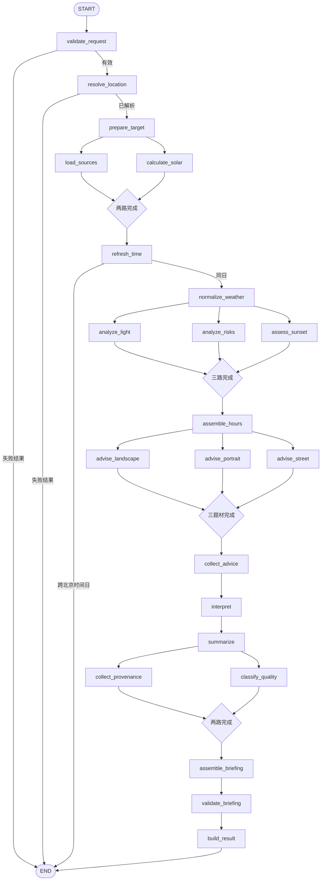
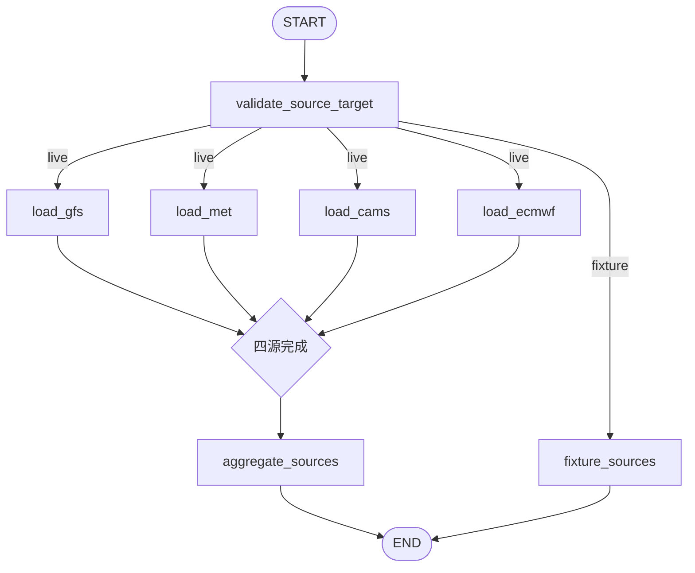

# 数据后端职责与 LangGraph 节点

本项目的数据后端由22节点简报主图、7节点取数图和3节点地点搜索图执行，共32个具名节点。模块承载业务职责，图定义依赖、并行和汇合；节点直接调用对应模块。SSR 与 `/api/briefing` 继续消费同一份 `BriefingResult`，公开 `Briefing` 结构和规则版本保持现有契约。

依赖固定为 `@langchain/langgraph@1.5.3`、`@langchain/core@1.3.0`。图使用 `Annotation.Root`、`StateGraph`、条件边与等待多节点的汇合边，参考 [LangGraph JavaScript Graph API](https://docs.langchain.com/oss/javascript/langgraph/graph-api)。当前没有大模型调用、持久 checkpointer 或整份简报缓存。

## 执行关系

[主图](../src/server/briefing-service/graph.ts)由 [service.ts](../src/server/briefing-service/service.ts)编译并调用；正式 [入口](../src/server/briefing-service/index.ts)注入服务端时钟、地点解析和源加载依赖。主图中的 `load_sources` 调用 [来源入口](../src/server/source-loader/index.ts)，后者经 `createSourceLoader` 建立每次请求的[取数图](../src/server/source-loader/graph.ts)。取数图在函数边界内调用，并非主图中直接注册的 LangGraph 子图对象。

`/api/locations` 通过 [location-service](../src/server/location-service/)运行独立地点搜索图；简报主图中的 `resolve_location` 仍使用同一地点provider的ID解析职责。



图中菱形只表示等待汇合，不是额外节点。

## 主图职责映射

节点适配器位于 [briefing-service/nodes](../src/server/briefing-service/nodes/)，领域及内容计算通过独立纯函数提供。表中输入列只列该职责使用的主要状态。

| 节点 | 单一职责与主要输入 → 输出 | 实现模块 |
| --- | --- | --- |
| `validate_request` | 校验地点ID并读取请求起始时间；`place` → `id`、`requestedAt` 或失败 `result` | [request.ts](../src/server/briefing-service/nodes/request.ts)、[geocoding/adapter.ts](../src/server/providers/geocoding/adapter.ts) |
| `resolve_location` | 解析并校验地点及ID一致性；`id` → `location` 或失败 `result` | [request.ts](../src/server/briefing-service/nodes/request.ts)、[geocoding](../src/server/providers/geocoding/) |
| `prepare_target` | 确定北京时间目标日和坐标；`location`、`requestedAt` → `localDate`、`target` | [request.ts](../src/server/briefing-service/nodes/request.ts)、[time](../src/domain/time/) |
| `load_sources` | 调用取数图；`target` → `loaded` | [weather.ts](../src/server/briefing-service/nodes/weather.ts)、[source-loader](../src/server/source-loader/) |
| `calculate_solar` | 计算天文事件；`localDate`、`location` → `solar` | [weather.ts](../src/server/briefing-service/nodes/weather.ts)、[solar](../src/domain/solar/) |
| `refresh_time` | 取装配时钟，阻止跨日数据改标签；`requestedAt`、`localDate` → `now` 或失败 `result` | [request.ts](../src/server/briefing-service/nodes/request.ts) |
| `normalize_weather` | 对齐三源逐时数据并校验摄影上下文；`target`、`loaded`、`location`、`now` → `day` | [weather.ts](../src/server/briefing-service/nodes/weather.ts)、[normalization](../src/domain/normalization/)、[context.ts](../src/domain/photography/context.ts) |
| `analyze_light` | 逐小时中点光线分析；`day`、`solar`、`location` → `light` | [photography.ts](../src/server/briefing-service/nodes/photography.ts)、[hour-light.ts](../src/domain/photography/hour-light.ts) |
| `analyze_risks` | 保留逐源风险再合并；`day` → `risks` | [photography.ts](../src/server/briefing-service/nodes/photography.ts)、[hour-risks.ts](../src/domain/photography/hour-risks.ts) |
| `assess_sunset` | 基于独立ECMWF空间输入分析晚霞；`day`、`solar`、`now`、`loaded.sunset` → `sunsetOpportunity` | [photography.ts](../src/server/briefing-service/nodes/photography.ts)、[sunset.ts](../src/domain/photography/sunset.ts) |
| `assemble_hours` | 组合公开小时对象；`day`、`light`、`risks` → `hours` | [photography.ts](../src/server/briefing-service/nodes/photography.ts)、[hours.ts](../src/domain/photography/hours.ts) |
| `advise_landscape` | 生成并校验风光建议 → `landscapeAdvice` | [advice.ts](../src/server/briefing-service/nodes/advice.ts)、[genre.ts](../src/domain/photography/genre.ts) |
| `advise_portrait` | 生成并校验人像建议 → `portraitAdvice` | 同上 |
| `advise_street` | 生成并校验街拍建议 → `streetAdvice` | 同上 |
| `collect_advice` | 将三份独立建议组成题材映射 → `advice` | [advice.ts](../src/server/briefing-service/nodes/advice.ts) |
| `interpret` | 根据小时、建议、晚霞与来源生成中文解释 → `interpretation` | [interpretation.ts](../src/server/briefing-service/nodes/interpretation.ts)、[content/interpret](../src/content/interpret/) |
| `summarize` | 根据小时、建议与解释生成摘要 → `summary` | [summary.ts](../src/server/briefing-service/nodes/summary.ts)、[content/summary.ts](../src/content/summary.ts) |
| `collect_provenance` | 汇总来源、格点、时效备注及天文出处 → `sources`、`warnings` | [provenance.ts](../src/server/briefing-service/nodes/provenance.ts) |
| `classify_quality` | 判断缺失、旧值、失败及未知状态 → `quality` | [quality.ts](../src/server/briefing-service/nodes/quality.ts) |
| `assemble_briefing` | 将已计算结果组成公开候选对象 → `candidate` | [output.ts](../src/server/briefing-service/nodes/output.ts) |
| `validate_briefing` | 使用完整公开契约校验候选对象 → `data` | [output.ts](../src/server/briefing-service/nodes/output.ts)、[schemas](../src/domain/schemas/) |
| `build_result` | 生成状态码、数据及错误信封 → `result` | [output.ts](../src/server/briefing-service/nodes/output.ts)、[result.ts](../src/server/briefing-service/result.ts) |

三个题材节点各自接收同一份 `day`、`solar`、`location`、`now` 和 `sunsetOpportunity`，可独立替换能力。原 [analyzePhotography](../src/domain/photography/index.ts) 保留为这些纯函数的组合入口，不承担 I/O，也不读取隐式时钟。

## 取数图与源模块



| 节点 | 职责 | 结果通道及模块 |
| --- | --- | --- |
| `validate_source_target` | 校验目标日、地点、坐标及请求时钟，按显式模式路由 | [graph.ts](../src/server/source-loader/graph.ts)、provider `targetSchema` |
| `fixture_sources` | 读取并校验人工样例，生产环境拒绝运行 | `result`；[fixture-loader.ts](../src/server/source-loader/fixture-loader.ts) |
| `load_gfs` | 独立运行GFS源加载用例 | `weather`；[hourly.ts](../src/server/source-loader/hourly.ts)、[open-meteo](../src/server/providers/open-meteo/) |
| `load_met` | 独立运行MET交叉检查用例，保留身份和共享缓存前提 | `crosscheck`；[hourly.ts](../src/server/source-loader/hourly.ts)、[met-norway](../src/server/providers/met-norway/) |
| `load_cams` | 独立运行CAMS空气质量用例 | `air`；[hourly.ts](../src/server/source-loader/hourly.ts)、[air-quality](../src/server/providers/air-quality/) |
| `load_ecmwf` | 独立加载日落方向空间云场，捕获源级失败 | `sunset`；[sunset.ts](../src/server/source-loader/sunset.ts)、[sunset-ecmwf](../src/server/providers/sunset-ecmwf/) |
| `aggregate_sources` | 按固定GFS／MET／CAMS顺序汇总快照、空间源、去重告警和缓存状态 | `result`；[graph.ts](../src/server/source-loader/graph.ts) |

源节点内部继续按职责拆分，缓存客户端不进入图状态：

| 模块 | 职责 |
| --- | --- |
| [loader.ts](../src/server/source-loader/loader.ts) | 建立一次请求的时钟、ID、取消控制器与6秒聚合定时器；运行取数图并在结束后清理定时器 |
| [types.ts](../src/server/source-loader/types.ts) | 源加载结果、依赖、日志白名单和请求运行资源类型 |
| [registry.ts](../src/server/source-loader/registry.ts) | 固定来源描述与默认provider映射 |
| [hourly.ts](../src/server/source-loader/hourly.ts) | 单个逐时源的启用、缓存读写、传输调用、降级和日志生命周期 |
| [hourly-fetch.ts](../src/server/source-loader/hourly-fetch.ts) | 单源传输、4秒预算及聚合取消传播 |
| [hourly-policy.ts](../src/server/source-loader/hourly-policy.ts) | 目标一致性、年龄、覆盖、旧快照回用及新缓存记录的纯决策 |
| [sunset.ts](../src/server/source-loader/sunset.ts) | 独立空间源的缓存和传输生命周期 |
| [sunset-policy.ts](../src/server/source-loader/sunset-policy.ts) | 采样计划一致性、空间云场复用及缓存记录的纯决策 |
| [abortable.ts](../src/server/source-loader/abortable.ts) | 让等待工作响应取消并清理监听器 |
| [cache](../src/server/cache/) | key、记录schema、TTL和可替换存储接口，隔离Vercel SDK适配 |
| [providers](../src/server/providers/) | 固定服务端上游端点、参数、响应适配和归一化输入 |

fixture 路由不会调用真实来源；live 失败不会回退fixture。各源节点调用自己的加载用例，不重复调用完整四源入口。

## 地点搜索图与provider职责


| 节点 | 单一职责与输入 → 输出 | 实现模块 |
| --- | --- | --- |
| `validate_query` | 校验查询长度和字符并去除首尾空白；`query` → `validQuery` | [nodes.ts](../src/server/location-service/nodes.ts)、[geocoding/input.ts](../src/server/providers/geocoding/input.ts) |
| `search_locations` | 通过注入依赖调用现有缓存provider；`validQuery` → `candidates` | [nodes.ts](../src/server/location-service/nodes.ts)、[geocoding/index.ts](../src/server/providers/geocoding/index.ts) |
| `validate_results` | 校验最多10个完整地点结果；`candidates` → `locations` | [nodes.ts](../src/server/location-service/nodes.ts)、[LocationSchema](../src/domain/schemas/index.ts) |

[地点搜索图](../src/server/location-service/graph.ts)输入为 `{ query: unknown }`，输出为 `{ locations: Location[] }`；[service.ts](../src/server/location-service/service.ts)提供原有查询函数形状，[/api/locations](../src/app/api/locations/route.ts)继续负责参数数量、HTTP状态和错误信封。无效查询返回400，意外上游或结果错误归为503；成功的空数组仍是合法查询结果。

地点provider内部拆分如下，旧 [adapter.ts](../src/server/providers/geocoding/adapter.ts)保留兼容导出：

| 模块 | 职责 |
| --- | --- |
| [input.ts](../src/server/providers/geocoding/input.ts) | 搜索字符串和地点ID校验 |
| [normalization.ts](../src/server/providers/geocoding/normalization.ts) | 上游记录校验、行政区分类、中国大陆服务范围及北京时间归一 |
| [transport.ts](../src/server/providers/geocoding/transport.ts) | 固定Open-Meteo地点端点、4秒请求预算、HTTP与上游错误处理 |
| [upstream.ts](../src/server/providers/geocoding/upstream.ts) | 搜索／ID解析响应适配、候选去重、原始获取时间记录 |
| [provider.ts](../src/server/providers/geocoding/provider.ts) | 搜索和解析用例、24小时时效判断及未找到错误 |
| [metadata.ts](../src/server/providers/geocoding/metadata.ts) | provider版本、24小时缓存常量和来源元数据 |
| [types.ts](../src/server/providers/geocoding/types.ts) | 带获取时间的缓存条目与加载依赖类型 |
| [index.ts](../src/server/providers/geocoding/index.ts) | Next Data Cache生产装配，保持既有key与重验证配置 |

地点搜索图不另设缓存层。简报的 `resolve_location` 节点复用同一provider的 `resolveLocation`，保留24小时语义年龄及地点ID一致性校验。

## 类型状态与并行所有权

[BriefingState](../src/server/briefing-service/state.ts)的输入仅为 `place`，公开图输出仅为 `result`。内部通道保存地点ID参数、数字时间、地点、目标、原始源结果、归一化日、天文事件、规则结果、内容及待校验／已校验简报。[SourceGraphState](../src/server/source-loader/graph.ts)只保存目标、四源结果和聚合结果。

[LocationSearchState](../src/server/location-service/state.ts)保存原查询、已校验查询、provider候选和已校验地点数组；搜索依赖由工厂闭包提供。

状态中没有时钟函数、fetcher、缓存客户端、模型客户端、取消控制器、signal或定时器。主图依赖和能力由工厂闭包捕获；取数图的 `SourceGraphRuntime` 由每次 `createSourceLoader` 调用建立，包含时钟、开始时间、请求ID及聚合signal，由闭包传入节点。

并行阶段采用独占写入通道，不依赖完成先后，也不让多个节点并发覆盖同一字段：

| 并行阶段 | 独占输出 | 汇合条件 |
| --- | --- | --- |
| 来源与太阳 | `loaded` / `solar` | 两者完成后 `refresh_time` |
| 光线、风险、晚霞 | `light` / `risks` / `sunsetOpportunity` | 三者完成后 `assemble_hours` |
| 三题材建议 | `landscapeAdvice` / `portraitAdvice` / `streetAdvice` | 三者完成后 `collect_advice` |
| 出处与质量 | `sources`、`warnings` / `quality` | 两者完成后 `assemble_briefing` |
| 四源加载 | `weather` / `crosscheck` / `air` / `sunset` | 四者完成后 `aggregate_sources` |

新增并行节点时延续该方式；确需共同累积字段时，先为该通道定义确定性的reducer。类型状态不代替运行时校验：地点、来源记录、题材结果和最终 `Briefing` 仍经过各自schema。

## 服务端调用与观察节点

在服务端TypeScript模块中可以直接构建和调用主图：

```ts
import { createBriefingGraph } from "@/server/briefing-service";
import { resolveLocation } from "@/server/providers/geocoding";
import { loadSources } from "@/server/source-loader";

const graph = createBriefingGraph({ clock: Date.now, resolveLocation, loadSources });
const { result } = await graph.invoke({ place: "geonames:1800163" });
```

地点搜索图同样可以独立调用：

```ts
import { createLocationSearchGraph } from "@/server/location-service";
import { searchLocations } from "@/server/providers/geocoding";

const locationGraph = createLocationSearchGraph({ searchLocations });
const { locations } = await locationGraph.invoke({ query: "南昌" });
```

调试或上层编排需要逐节点更新时，选择 `stream`：

```ts
const updates = await graph.stream(
  { place: "geonames:1800163" },
  { streamMode: "updates" },
);
for await (const update of updates) {
  // update 以节点名为键，只包含该节点返回的状态更新。
  consumeNodeUpdate(update);
}
```

`consumeNodeUpdate` 代表调用方自己的处理函数。`invoke` 和 `stream` 各自启动一次计算；选择所需方式即可。主图流会看到 `load_sources` 的聚合更新，内部取数节点需要直接观察 `createSourceGraph(...).stream(...)`。直接使用低层取数图时，调用方须像 `createSourceLoader` 一样管理一次性runtime、6秒定时器和清理；正式业务入口继续使用loader。

`createBriefingService` 会将意外异常转换为稳定的 `BRIEFING_UNAVAILABLE` 信封。直接使用图或流时，调用方负责处理抛出的异常。当前HTTP API仍返回完整简报信封，没有新增流式HTTP端点。

## 异步模型或 agent 能力接入

[BriefingCapabilities](../src/server/briefing-service/contracts.ts)提供三个独立的异步接口，均接受返回值或Promise：

| 注入点 | 输入与输出 | 节点 |
| --- | --- | --- |
| `genreAdvice.landscape` / `.portrait` / `.street` | `GenreAdviceInput` → `GenreAdvice` | 对应 `advise_*` |
| `interpretation` | `InterpretationInput` → `Interpretation` | `interpret` |
| `summary` | `SummaryInput` → `Summary` | `summarize` |

未注入的接口使用现有纯规则和内容函数。下面用原摘要函数演示异步注入；接模型时可替换回调体，保持返回结构：

```ts
import { createBriefingService } from "@/server/briefing-service";
import type { BriefingCapabilities } from "@/server/briefing-service";
import { createSummary } from "@/content/summary";

const capabilities: BriefingCapabilities = {
  summary: async ({ hours, advice, interpretation }) =>
    createSummary(hours, advice, interpretation),
};

const getBriefing = createBriefingService(
  { clock: Date.now, resolveLocation, loadSources },
  capabilities,
);
```

能力回调接收 `structuredClone` 的独立输入副本，避免修改规则状态或污染并行题材分支。题材返回值经 `GenreAdviceSchema.parse` 校验并切断引用，同时核对题材；解释和摘要返回值也复制后再入状态，最终统一经 `BriefingSchema` 校验。能力抛错或返回不合契约的内容时，服务入口返回失败信封，不自动换用一份不同来源的结果。

模型或agent可以使用节点已有的结构化事实、来源和明确时间；取数、归一化及规则无需重写。模型客户端和凭证留在服务端能力闭包，不写入状态。能力实现自行处理其外部调用预算；来源的6秒预算只覆盖取数，不覆盖后续模型调用。

需要新增研究、工具调用或审核步骤时，可在 [createBriefingGraphBuilder](../src/server/briefing-service/graph.ts)基础上扩展类型状态和拓扑，明确其输入、输出、路由及汇合关系。能力仍须遵守 [规格](../spec.md)及 [AGENTS](../AGENTS.md) 的事实、来源、风险与产品文案要求；schema校验不会验证自然语言的事实正确性。

## 时间、缓存与故障契约

- `validate_request` 记录请求起始时钟，`prepare_target` 据此确定 `Asia/Shanghai` 产品日。取数和太阳完成后，`refresh_time` 使用不早于起始时刻的装配时钟；跨北京时间午夜直接返回 `BRIEFING_UNAVAILABLE`，不把前一天数据标成新一天。
- 规则使用状态中的显式 `now`。每次请求重新计算推荐、时态和晚霞机会，不持久缓存这些结论；原始来源缓存仍留在取数职责内。
- 逐时源15分钟、空间源1小时重验证；空间失败冷却15分钟。允许旧值保持原始 `fetchedAt`，年龄最多3小时且覆盖目标日；MET 304不改写获取时间，继续遵守 Expires 和 Retry-After。
- `createSourceLoader` 持有6秒聚合取消资源，源传输保留4秒预算。源级失败转换为对应缺失／失败结果，其他来源继续保留；取消后不启动迟到写入。
- MET 保留真实身份和可用共享缓存前提；`shared-configured` 仅表示配置事实。Vercel跨实例与配额行为的待验事项仍见 [CURRENT](CURRENT.md)。
- 数据状态顺序保留 `unavailable`、`stale`、`partial`、`ready` 的判断含义；全部天气与空气数据缺失时可返回带太阳计算的503简报。来源失败、旧值、未知和具体风险不会被内容能力隐藏。
- ECMWF空间源缺失时晚霞保持unknown，GFS只参与分歧限级；三源逐时归一化、逐源危险保留和推荐资格继续按现有领域契约执行。

对应验证入口及定向命令见 [开发说明](DEVELOPMENT.md)。
